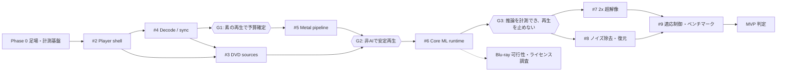

# RetroVision AI 開発計画

最終更新: 2026-11-15

本書は [Epic #1](https://github.com/kitanou/retrovision-ai/issues/1) とその実装 Issue #2〜#9 を、実装順序・依存関係・決定ゲート・完了条件に落とし込んだ実行計画です。仕様の本体は Epic と各 Issue が正であり、本書が矛盾する場合は Epic / Issue に従います。

- 対象 Epic: [#1](https://github.com/kitanou/retrovision-ai/issues/1)
- 実装 Issue: [#2](https://github.com/kitanou/retrovision-ai/issues/2) [#3](https://github.com/kitanou/retrovision-ai/issues/3) [#4](https://github.com/kitanou/retrovision-ai/issues/4) [#5](https://github.com/kitanou/retrovision-ai/issues/5) [#6](https://github.com/kitanou/retrovision-ai/issues/6) [#7](https://github.com/kitanou/retrovision-ai/issues/7) [#8](https://github.com/kitanou/retrovision-ai/issues/8) [#9](https://github.com/kitanou/retrovision-ai/issues/9)

## 1. 現状

| 項目 | 状態 |
|---|---|
| ソースコード | Phase 0 の足場と Phase 1 の demux/decode が実装済み（`Packages/RetroVisionKit`。`make check` で検証） |
| ビルド・CI | 設定済み（build / unit / integration / licenses / fixtures。nightly に probe 収集） |
| 依存関係 | 製品は**依存ゼロ**（AVFoundation + VideoToolbox 直行を EXP-001 で実証）。ffmpeg / libdvdnav 系は開発機にのみ導入（fixture 生成用。未リンク） |
| テスト素材・ベンチマーク | 合成 fixture 11 本を Git 同梱・manifest 登録（実素材 7 は pending＝OQ-16）。`make probe` で測れる |
| サードパーティライセンス棚卸し | 実施済み（`licenses/inventory.json` に実測値。すべて planned/未リンク） |

つまり計画の初盤は「機能追加」ではなく、**再生の基本線を計測付きで通せる土台づくり**から始めます。

## 2. 進め方の原則

1. **再生の連続性と A/V 同期が最優先**。AI 処理は常に省略でき、再生クロックを決して止めない。
2. **非 AI の Metal パイプラインを常設のフォールバック**として維持する。AI 段階は必ずバイパスできる構造にする。
3. **測ってから決める**。フレーム予算・モデル性能・デインターレーサの品質は、実測値なしに設計へ取り込まない。
4. **決定ゲートでスコープを切る**。ゲート不合格の領域（例: 実時間 2x SR）は、プロトタイプを残したまま製品スコープから外す判断を明示的に行う。
5. **UI・再生エンジン・強調化パイプラインを疎結合**に保つ。境界は Issue #2 の player-engine プロトコルで先に固定する。
6. **保護ディスクの扱いはライセンスゲートの内側**。回避や鍵の抽出は実装せず、要件に準拠した差し替え可能バックエンドに閉じ込める。

## 3. フェーズ分け

各フェーズは「動く成果物」で定義します。日付は置かず、ゲート通過で次へ進みます。

### Phase 0 — 足場づくり（先行作業 / Issue 化が必要）

既存 Issue の実装を成立させる前提作業です。ここを飛ばすと、後続の比較や計測が再現できなくなります。

- Xcode プロジェクト構成（アプリ / 再生エンジン / 強調化 / 診断のターゲット分割）と、Swift のモジュール境界に関する合意
- CI の構築（ビルド、静的解析、ユニットテスト、Metal / Core ML のコンパイル確認）
- 依存の配布方針の決定：FFmpeg・libdvdnav / libdvdread をどう導入・配布するか（SPM のバイナリ依存 / 自前ビルド / dynamic link のいずれか）と、配布物への影響
- **ベンチマーク基盤の骨格**：ステージ毎レイテンシ（decode / deinterlace / inference / post / present）、ドロップ・遅延フレーム、CPU/GPU/ANE 使用率、メモリを記録する仕組みを、最初のフレーム経路に最初から組み込む
- テスト素材セット v0 の整備（NTSC 480i、PAL 576i、プログレッシブ SD、アニメ、字幕焼き込み、エッジの扱いが難しい素材、ブロックノイズやモスキートノイズが目立つクリップ）と、レポート出力形式の確定
- サードパーティライセンスの棚卸し手順と記録ファイル（依存ライブラリとモデルのライセンス・配布義務）

完了条件: `xcodebuild` と CI が通り、空のフレーム経路に対してステージ毎レイテンシのレポートが、再現手順付きで出力できる。

### Phase 1 — 単発ファイルの再生基本線（[#2](https://github.com/kitanou/retrovision-ai/issues/2) → [#4](https://github.com/kitanou/retrovision-ai/issues/4)）

意図: **#2 と #4 はこの順序で、ただし一つのかたまりとして**進めます。UI の再生操作は player-engine プロトコルを介して実行され、その実体が #4 のデコーダになります。

1. #2: アプリシェル、比率維持のビデオ表示、Open File、再生操作、音量、全画面、設定 UI（状態はプレースホルダ）
2. #4: ~~FFmpeg による demux~~ → **AVFoundation demux（ES パススルー）/ VideoToolbox ハードウェアデコード**（EXP-001 で FFmpeg なしで成立と決定済み。ソフトウェアフォールバックは OQ-20 ゲート）、CVPixelBuffer への正規化、タイムスタンプ・フレーム長・色メタデータ・DAR の保持、AVFoundation / CoreAudio クロック、seek / pause / トラック選択

**進捗（2026-11-16）**: #4 の映像経路 ＋ **EngineCore との実接続（#11・映像再生線）** ＋ **音声線（#10: AC-3→PCM 復号・AudioSink・audio master clock）が完了・実測済み**。11 素材すべて最後まで完走、NTSC/PAL/24p の提示間隔が目標に一致、realTimeFactor ≥0.997。AC-3 素材で drift p50 +6.9 / p95 +10.6 ms（04 §5 の帯域内）・underrun 0（`make probe-play` で再現）。**ゲート G1 は条件付きで判定可**（下の G1 節に実測で判定を記録）。残りは seek（#13）、warmup（#12・OQ-18）、#2 の UI。

ゲート G1（このフェーズ末で判定）: **AI なしの素の再生パスで、目標マシン（M5 Max 64GB）にて 29.97 / 25 fps が破綻せず、ステージ別の測定値から後段（Metal・Core ML）に使える残り予算が確定する。**

**G1 判定（2026-11-16・条件付き PASS。根拠は 04 §9 の in-loop 実測表）**:
- 破綻なし: 合成 11 素材がすべて最後まで完走。提示 realTimeFactor ≥0.997、NTSC 33.36 / PAL 40.00 / 24p 41.66 ms が目標に一致。音声 clock 権威の AC-3 素材でも提示間隔 p50 は破綻せず、drift は p95 +10.6 ms（04 §5 の補正段階の帯域内）・underrun 0。
- 残り予算（仮配分の実測への置換）: demux+HW decode 段 p50 — MPEG-2 2.6 ms / H.264 progressive 1.6〜1.9 ms / **H.264 interlaced 5.7 ms**。33.37 ms に対する後段（Metal・Core ML）の目安は **27〜30 ms**（H.264 interlaced を DVD 相当で扱う場合は 27 ms 側。04 §9）。
- 条件（残る検証）: ①**実素材 7 本での再実行**（合成素材のみで判定。OQ-16 / #15）。②**warmup**（初帧 44〜70 ms のスパイク、OQ-18 / #12。fps の破綻ではないが起動 UX と初帧測定の質に関わる）。③drift の長時間・実盤分布（R8 の懸念。合成 6 s では 0 累積を確認したにとどまる）。
- 数値の注意: `make probe` の初复号スパイク（44〜70 ms）は warmup 前の値で、常時再生の stage 値は in-loop 表を使う。

- 判定資料: 代表クリップでのフレーム間隔ヒストグラム、ドロップ数、A/V ドリフト
- 不合格の場合: 後段の予算を減らす（解像度・モデル規模を落とす）か、後段を非リアルタイム処理へ退避させる

完了条件: #2 と #4 の受け入れ基準を満たし、一般的な動画ファイルが安定再生でき、HW/SW デコードの選択と遅延が計測できる。

### Phase 2 — GPU パイプラインと DVD ソース（[#5](https://github.com/kitanou/retrovision-ai/issues/5) ∥ [#3](https://github.com/kitanou/retrovision-ai/issues/3)）

#5 と #3 は依存関係が薄く並行できますが、**#5 を主線**にします。デインターレースと色・比率の正しさは、その後のすべての画質評価の基準になるためです。

- #5: CVPixelBuffer のコピーほぼゼロでの取り込み、スケーリングと色変換、NTSC 480i / PAL 576i のデインターレーシング評価、フィールド順序・キャデンス・ピクセル比・表示比率・レンジの保持、合成可能なフィルタ段階とフレーム寿命管理、再生・音声スレッドを止めない表示
- #3: 光学ドライブの検出、VIDEO_TS / ISO の選択、libdvdread / libdvdnav の統合評価、title / chapter / 尺 / 音声トラック / 字幕のメタデータ、**光学ドライブ・フォルダ・ISO を同一の再生インターフェースに通す source abstraction**、メディア取出し・不正メディア・権限エラーの安全な扱い

ゲート G2: **AI を無効にした Metal 経路で安定再生が続く、間隔と比率が正しい、選択したデインターレースモードでテストクリップにコーミングが残らない。** GPU ステージのレイテンシが測定済みで、G1 の残り予算内に収まっている。

補足: CSS 保護ディスクの再生はこのフェーズでは扱いを保留します（#3 の Notes のとおり、要件に準拠した差し替え可能バックエンドの内側に隠す）。再生検証は非保護 / ユーザーオーサリング盤に限定します。

### Phase 3 — Core ML 実行基盤とモデル選定（[#6](https://github.com/kitanou/retrovision-ai/issues/6) + [#7](https://github.com/kitanou/retrovision-ai/issues/7) の評価部分）

モデルを流し込む前に、**実行層と計測の器を先に完成**させます。

- #6: モデルのメタデータ・I/O テンソル契約・寿命管理、コンパイル済み Core ML の安全な load / unload、compute unit 構成（ANE / GPU / CPU / automatic）の実測比較、Metal・CoreVideo ↔ テンソル変換の効率化（CPU readback を不要にし、変換コストは分離して計測）、代表 SD フレームと合成入力によるテストハーネス、モデルのバージョン・ライセンス・入力次元・精度・実行設定の記録
- #7 の前段: Real-ESRGAN x2plus とアニメ寄りモデルの比較評価（画質、時間的な安定性、リンギング、テクスチャの幻覚、遅延、メモリ、Core ML 変換の複雑さ）

ゲート G3: **少なくとも 1 つのモデルが復号フレームに対して end-to-end で動作し、推論遅延・メモリ・変換コストが測定済みで、失敗やタイムアウトが再生を止めない。**

- ここで「480p → 約 960p/1080p を 33.4 ms 以内に収める見込みがあるか」を判定します。見込みがあれば Phase 4 で実運用へ進めます。なければ #7 は「非リアルタイム / 手動実行の復元機能」として製品スコープを縮小し、非 AI 経路を製品の標準品質として確定します。

### Phase 4 — 強調化の実運用（[#7](https://github.com/kitanou/retrovision-ai/issues/7) の統合、[#8](https://github.com/kitanou/retrovision-ai/issues/8)）

- #7 の後段: 選定モデルを Metal / Core ML の段階として統合、480p → 約 960p/1080p を目指し、大型ディスプレイでは Metal スケーリングで補う、モデル選択と AI on/off の UI 制御
- #8: DVD 由来アーティファクトの分離した特性評価（ブロックノイズ、リンギング、モスキートノイズ、色ノイズ、アナログの粒子）、軽量な学習ベースのノイズ除去と従来型 Metal フィルタの比較、顔・アニメの線画・粒子・細部のテクスチャを塗り潰さない設定設計、ノイズ除去／復元強度の独立制御、**デインターレース・超解像との処理順を設定可能**にする、before / after キャプチャと客観・主観の記録

完了条件: 再生を止めずに on/off・強度の変更ができ、既定値は保守的。テストセットで深刻な時間方向のフリッカや細部の塗り潰しが無く、遅延とメモリの増加分を記録済み。

### Phase 5 — 適応制御とベンチマーク確定（[#9](https://github.com/kitanou/retrovision-ai/issues/9)）

- ステージ別の独立測定、フレーム期限・キュー長・ドロップ／遅延・CPU/GPU/ANE・メモリの追跡
- 降格ポリシーの確定：任意フィルタの無効化 → 軽量モデルへの切替 → 推論スケールの縮小 → 強調化フレームの間引き → Metal スケーリングへのフォールバック
- オーディオクロックと再生の連続性を権威とし、AI の処理が再生クロックを絶対にブロックしない
- M5 Max 64GB 向けの再現可能なベンチマーククリップとレポート形式、実行中の診断表示、ユーザーに見える品質／性能インジケータ

完了条件: 意図的に負荷を掛けた推論でも再生の連続性が保たれ、負荷が下がれば品質が戻る。ベンチマーク結果がモデル・パイプラインの改訂をまたいで再現できる。

### Phase 6 — Blu-ray の可行性とライセンス（独立ゲート付きワークストリーム）

Epic の Milestone 7 に対応します。Phase 3 以降は調査のみ並行して走らせ、製品スコープへの投入はゲート合格後です。

1. 非暗号化 / ユーザーオーサリング BD（フォーマットとライブラリのライセンス確認）
2. 商用 AACS 保護 BD（要件に適合したライセンス済み再生実装と、必要な契約・認証がある場合のみ）
3. **保護済みの復号フレームを自作の Metal / Core ML 経路に通せるか**をライセンサーまたは SDK ベンダーに確認する。再生ライセンスが任意のフレーム処理や出力経路を許すと仮定しない。

## 4. 依存関係

並行化の方針:

- **#3 は #2 の完了後、#5 と並行**して進められます（source abstraction は player-engine プロトコルに依存し、GPU 経路には依存しないため）。
- **#8 の特性評価作業（アーティファクト分類、テストセット作成）は Phase 2 から前倒し**できます。画質評価の土台は早いほど良いです。
- **#9 の計測項目の定義は Phase 0 で決め、各 Phase で少しずつ実装**します。最後にまとめて計測機構を作ると、過去の判断を検証し直せません。
- Blu-ray のライセンス確認はリードタイムがあるため、Phase 3 以降の「余裕があれば」ではなく、**問い合わせを先に済ませる**必要があります。

## 5. フレーム予算の仮配分（検証前）

33.4 ms（29.97 fps）を次の通りに仮配分し、G1 / G2 / G3 で実測に置き換えます。**これは保証ではなく仮説です。**

| 段階 | 仮予算 | 測定するまで不明な点 |
|---|---|---|
| Demux + HW decode | ≤ 5.5 ms → **VideoToolbox 単体は実測で预算内**（decode p50 0.4〜1.7 ms、スループット 176〜1555 fps。[EXP-001](experiments/EXP-001-dependency-and-videotoolbox.md) §4）。open 1.4〜28.5 ms と**初帧 44〜70 ms の warmup**（OQ-18）が別枠 | **in-loop 実測済み**（`make probe-play`。再生線 decode 段 p50: MPEG-2 2.6 ms / H.264 progressive 1.6〜1.9 / **H.264 interlaced 5.7**。数値と late の归属は 04 §9） |
| 音声復号・同期（audio clock） | （予算表に項目なし。04 §1 のスレッド設計では再生スレッド外） | **実測済み（#10）**: AC-3→PCM 変換 realtimeFactor ≈1100（EXP-002）、in-loop で供給による音声途切れ 0（underrun 0）、drift p50 +6.9 / p95 +10.6 ms。同期破綻なし。表の項目追加は Phase 2 の SyncController 実装時に（04 §5/§9） |
| Deinterlace + 色変換 | ≤ 3 ms | 選択方式の GPU コスト |
| Core ML 推論（2x） | ≤ 18 ms | ANE と GPU の差、テンソル変換の実コスト |
| Post / ノイズ除去 | ≤ 2 ms | 各段を直列にした場合の合成コスト |
| 最終スケーリング + 表示 | ≤ 1.5 ms | 4K 表示時の負荷 |
| ヘッドルーム | ≥ 3 ms | 断続的な処理の伸びの吸収 |

合計は 33.0 ms（29.97 fps のフレーム間隔 33.37 ms 以内に収める）。この配分は `FrameBudget.initialDraft` としてコードに持ち、plan 生成時に総和がフレーム間隔を超えるか検証する（設計 [05 §1](design/05-metal-pipeline.md)）。合計が仮予算を超える場合は、Phase 3 のゲートで**解像度・モデル規模・処理順**を削る方向に倒す。

## 6. 完了条件（Epic の Definition of Done に対応）

- 対応する DVD ソースと一般的な動画ファイルを、安定した A/V 同期で再生できる
- インターレースを正しく扱い、表示比率が保たれる
- 再生を止めずに強調化を on/off できる
- AI がフレーム予算に合わないとき、滑らかにフォールバックする
- ベンチマークがフレーム遅延、ドロップフレーム、CPU/GPU/ANE 使用率、メモリを報告する
- サードパーティ依存とモデルのライセンスが文書化されている
- 保護ディスク再生は、必要なライセンスと順守作業が終わるまで謳わない

## 7. リスクと対応

| # | リスク | 発生兆候 | 対応策 |
|---|---|---|---|
| R1 | 2x SR がリアルタイムに収まらない | G3 で推論＋変換が 18 ms を超える | 軽量モデル／一部領域の推論／間引きへ切替え、#7 を非リアルタイム機能へ縮小。非 AI 経路を標準品質として出荷 |
| R2 | Core ML 変換が想定より重い、または ANE に載らない | 変換コストが推論本体を超える | compute unit を GPU 構成で確定、モデル構造を簡略化、MLX で研究したモデルの採用を見送り |
| R3 | 時間的な安定性の欠如（フリッカ・ゆらぎ） | 静止画評価は良いのに連番で破綻する | 評価セットを連番クリップ中心に変更、時間方向の制御がある方式へ寄せる、強度の下限設定で抑える |
| R4 | 再生パスと AI 段が結合し、フォールバックが消える | on/off が再生停止を伴う変更になる | #2 の player-engine プロトコルを先に固定し、強調化段は必ずバイパス可能・モデル unload 可能であることをテストで担保 |
| R5 | FFmpeg / libdvdnav の配布・ライセンス実務が詰まる | 配布物の再配布条件が確定しない | Phase 0 で導入方式と配布方針を決め、記録ファイルに落とす。保護ディスクは要件に準拠したバックエンドの内側に封じる |
| R6 | 保護ディスクのライセンスが成立しない | 権利範囲の回答が得られない | 非保護 / ユーザーオーサリングのみを製品対応と明示し、保護ディスクは謳わない（Epic の DoD に一致） |
| R7 | Blu-ray が無計画に設計へ漏れ出す | MPEG-2 を前提とした仮定が壊れる | Phase 6 をゲート付きの分離ワークストリームに保ち、BD 対応を MVP 判定に入れない |
| R8 | 後段の処理増で A/V 同期の劣化が顕在化する | 長時間再生での音声ドリフト | G1 でクロック設計とドリフト測定を必須化。AI 段は非同期キューのみに置き、オーディオを常に権威にする |
| R9 | 測定条件が版をまたいで変わり、比較できなくなる | 数値が再現しない | Phase 0 でクリップ・レポート形式・マシン設定を固定し、結果をコミット対象の成果物として保存 |
| R10 | 範囲の拡大（Blu-ray、字幕、多言語、配信形式など） | Issue の追加が実装速度を上回る | MVP 判定を Phase 5 の完了条件に結びつけ、未着手 Issue の優先度（P0 / P1）を毎回見直す |

## 8. MVP 判定とその後

Phase 1〜5 がゲートを通過した時点で、MVP としての判断材料は次の組み合わせです。

- DVD ソース（非保護 / ユーザーオーサリング）と一般ファイルの安定再生
- 正しいデインターレース・比率・色と、AI なしの Metal 品質経路
- 実測値に裏付けられた AI 強調化（リアルタイムに載らない場合は、その事実と代替経路を明記して出荷）
- 適応制御とベンチマークレポート

未完了・保留として明確に切り出すもの: CSS / AACS 保護ディスク、Blu-ray、追加モデルの画質ラインナップ、字幕の高度な描画。

## 9. 足場の作業（進捗）

既存 Issue の前に切る作業の一覧。詳細は [実装状況](design/README.md#現在実装状況phase-0-の足場) を参照。

| # | 作業 | 状態 |
|---|---|---|
| 1 | Phase 0 の足場（SPM 構成・ビルド・CI・make タスク） | 完了（`Packages/RetroVisionKit`、`.github/workflows/ci.yml`、`Makefile`） |
| 2 | 計測基盤とレポート形式（#9 の前倒し） | 完了（`MetricBus`、JSONL、`BenchmarkReport`。実測値での閾値改定は未了） |
| 3 | 純粋ロジックの先行実装（比・キャデンス計画・適応制御） | 完了（テストで固定） |
| 4 | 依存の導入方針（FFmpeg / libdvdnav のビルド・配布形） | **縮小**（2026-11-16、EXP-001）: ファイル再生に依存なし。残りは DVD 制御（Phase 2 の block-reader 実験）と WMV1（Phase 4 ゲート、OQ-20）。OQ-01 / OQ-02 の決定ログ参照 |
| 5 | テスト素材セットの取得元と sha256（#7 / #8 の共通基盤） | 合成 11 本を Git 同梱・manifest 登録（`kind: generatedFile` + 実測 sha、sha は記録扱い）。実素材 7 は pending（OQ-16） |
| 6 | 保護ディスク（CSS）と Blu-ray のライセンス問い合わせ | 未着手。OQ-03 / OQ-15（リードタイムがあるため早期に問い合わせる） |
| 7 | player-engine プロトコルの実装（#2 の本体 UI は未着手） | プロトコル・状態機械・plan 生成まで実装。UI とデコード接続は Phase 1 |
| 8 | Python / coremltools 環境（モデル変換） | 未着手。OQ-07 |
| 9 | 映像 demux + VideoToolbox 復号（#4 の映像本体） | **完了**（AVFoundation ES パススルー + VT 直行。全 10 fixture 通過、提示順の順序保証を統合テストで固定） |
| 10 | MPEG-2 bitstream 解析（frame rate / field 順序の一次情報） | **完了**（ffprobe と byte-for-byte 突合。PCE 解析。回帰テスト 14 本） |
| 11 | 合成 fixture 生成・登録・検査（gen-fixtures / check-fixtures） | **完了**（10 本 Git 同梱。実素材は OQ-16） |
| 12 | probe 計測基盤（`make probe` / `make probe-play` + nightly 収集） | **完了**（映像 + 音声 in-loop の両計測。clock drift・underrun も実測済み → 04 §9。残るは実素材での再測＝OQ-16 と warmup＝OQ-18） |
| 13 | EngineCore ↔ demux/decode の実接続（#11・映像再生線） | **完了**（PlaybackSession + FileMediaSource。11 素材完走・realTimeFactor ≥0.997・提示間隔は目標に一致（04 §9）。統合テスト 4 本）。seek（#13）・warmup（#12）は別作業 |
| 14 | 音声線（#10: `AVFoundationAudioDecoder` / `AVFoundationAudioSink` / `AudioClock`） | **完了**（AC-3→PCM 変換 + 480 帧 quantum、framePosition↔PTS 対応表、audio master clock が提示締切の権威。AC-3 素材で drift p50 +6.9 / p95 +10.6 ms・underrun 0。単体 4 本 + e2e 3 本）。DTS は A6 のため Phase 4 shim ゲートまで非対応（回帰テストで固定）。drift の補正行動（SyncController）は Phase 2 |

## 10. 関連

- [設計文書一覧](design/README.md)（詳細設計: モジュール分割、型・プロトコル契約、スレッドモデル、適応制御、テスト戦略）
- [未決事項の意思決定ログ](design/10-open-questions.md)
- [README](../README.md)
- [Epic #1](https://github.com/kitanou/retrovision-ai/issues/1)
