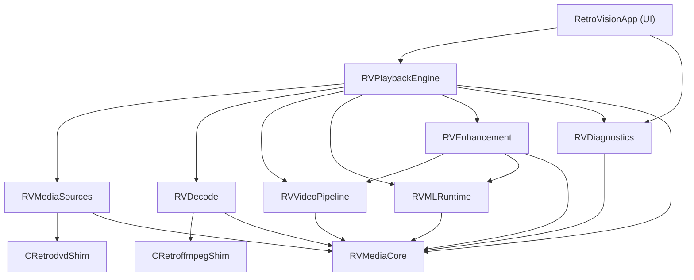
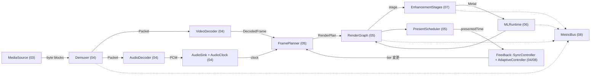

# 00. アーキテクチャ

対象: Issue #2〜#9 全体。Phase 0 でこの構造を確定させる。

## 1. 構造の方針

- 再生エンジン・GPU 強調化・UI を疎結合にする（Epic の要求）。境界は値型（[01-core-types.md](01-core-types.md)）とプロトコル（[02](02-player-engine.md) / [03](03-media-sources.md) / [06](06-ml-runtime.md)）で固定し、実装の差し替えを許す。
- サードパーティ C ライブラリ（FFmpeg、libdvdnav / libdvdread）は**専用シムモジュールに閉じ込める**。上位は C 型を一切触らない。
- 「AI なし」が常に動く構造をデフォルトにする（INV-2）。AI 段階は後から挿入するモジュールであり、中核は AI を知らない。

## 2. 実装形態（SPM + アプリターゲット）

単一 Xcode プロジェクトではなく、**ローカル SPM パッケージ + アプリターゲット**を基本にする。CI がパッケージだけを対象にテストでき、GPU 系テストをアプリから分離できるため。

```
RetroVision.xcworkspace
├── App/RetroVisionApp                 # SwiftUI ターゲット。エンジン実装ではなくプロトコルに依存
└── Packages/RetroVisionKit/
    ├── RVMediaCore/                   # 値型のみ。他モジュールに依存しない
    ├── RVMediaSources/                # ソース抽象 + DVD 構造モデル（#3）
    │   └── CRetrodvdShim/             # libdvdread / libdvdnav の C シム
    ├── RVDecode/                      # demux / デコード / 音声 / 同期（#4）
    │   └── CRetroffmpegShim/          # FFmpeg の C シム
    ├── RVVideoPipeline/               # Metal レンダーグラフ、deint、色・比（#5）
    ├── RVMLRuntime/                   # Core ML 実行層（#6）
    ├── RVEnhancement/                 # SR / denoise のステージ定義（#7、#8）
    ├── RVPlaybackEngine/              # PlayerEngine 実装、同期・適応制御（#2/#4/#9 の統合）
    ├── RVDiagnostics/                 # メトリクスバス、ベンチマークレポート（#9）
    └── BenchTools/                    # benchmark-runner CLI（#9）
```

依存方向（この矢印以外は禁止。CI で import チェックを機械化する）:



禁止事項:

- `RVVideoPipeline` / `RVMLRuntime` / `RVEnhancement` が `RVDecode` を import しない（フレームは RVMediaCore の型で受け渡す）。
- UI が `RVDecode` 等の実装モジュールを直接 import しない（INV-8）。
- `RVMediaCore` は Foundation / CoreMedia 以外の依存を持たない。

## 3. グローバル不変条件（すべての設計・テストが守る）

| ID | 不変条件 | 担保方法 |
|---|---|---|
| INV-1 | AI・強調化処理は音声クロックと再生クロックをブロックしない | 強調化は非同期キューのみ。音声側は強調化の完了を待たない（08 §2） |
| INV-2 | AI を無効にした経路が常に成立する（フォールバックは事後対策ではない） | StageGraph は `.off` tier を常に持つ。テストで .off の完全パスを要求 |
| INV-3 | 設定・tier 変更はフレーム境界でのみ有効化される | 生成済みの RenderPlan は不変。planID をフレームに焼き付けて比較（05 §4） |
| INV-4 | ブロッキングする C API（FFmpeg・libdvdnav）は Swift 並行性の協調スレッドから呼ばない | 専用 serial queue に閉じ、`withCheckedContinuation` で橋渡し（§5） |
| INV-5 | CVPixelBuffer / MTLTexture の再利用は参照カウントで管理し、生存期間の推測で上書きしない | `FrameHandle` の lease 数で検証。違反はアサート＋診断ログ（01 §4） |
| INV-6 | すべてのステージは計測点を持つ。計測のないステージは追加できない | `StageID` を enum で中央管理。未登録 ID はビルド失敗 |
| INV-7 | 保護ディスク（CSS / AACS）の扱いは差し替え可能バックエンドの内側に閉じる | `DVDCssBackend` プロトコル。中核は保護の意味を知らない（03 §7） |
| INV-8 | UI は PlayerEngine プロトコルにのみ依存する | 型レベルで分離。FakePlayerEngine で UI 単体テストが可能（02 §6） |

## 4. プロセスモデルとプロセス内分離

単一プロセス（macOS ネイティブアプリ）とし、権限・不安定性の分離はプロセス内で行う。

- **プロセス分割をしない理由**: フレームの受け渡し（1 秒に 30 本 × 1080p）を IPC で跨ぐとコピーと同期のコストがフレーム予算（33.4 ms）を圧迫する。外部プロセス化を検討するのは、保護ディスクのライセンス済み SDK が隔離を要求する場合のみ（OQ-05）。
- 不安定な入力（ISO・壊れた VIDEO_TS・未知のコーデック）は、例外・エラー値で処理し、クラッシュを想定した監視は置かない。C API 側のクラッシュに備え、デコード系は入力検証と limit（解像度上限・サンプルレート上限）で防御する（04 §8）。

## 5. スレッドモデル

| 実行体 | 種別 | 担当 | 呼び出し規則 |
|---|---|---|---|
| MainActor | Swift actor | UI、ViewModel、ユーザー操作の受付 | 重処理禁止。フレームレート関連の処理もしない |
| `PlayerEngine` | Swift actor | 状態機械、選択の管理、plan の生成 | ブロッキング処理・GPU 呼び出し禁止。queue への投入のみ |
| `demuxQueue` | 専用 serial DispatchQueue | FFmpeg demux、ソース IO | INV-4。同期 C 呼び出しはここだけ |
| `videoDecodeQueue` | 専用 serial DispatchQueue | VideoToolbox / SW デコード、CVPixelBuffer 確保 | 同上 |
| `audioQueue` + AVAudioEngine render thread | realtime | PCM 生成、音声クロック更新 | realtime thread での確保・ロック・Swift 並行性禁止。事前スケジュール済 buffer のみ |
| `renderQueue` | 専用 serial DispatchQueue | Metal コマンドエンコード、present 予約 | `inFlight` 最大 3（初期値）。drawable 取得はここだけで行う |
| `mlQueue` | 専用 serial DispatchQueue + async 実行 | Core ML 推論、テンソル変換 | deadline 付き。完了が遅い結果は捨てられる（INV-1） |
| `diagnosticsQueue` | 専用 serial DispatchQueue | メトリクス集計、レポート書き出し | 再生パスからは fire-and-forget。backpressure で再生を待たせない |

データ受け渡しの規約:

- actor 間・queue 間の受け渡しは `Sendable` な不変構造体のみ。C API のポインタはシムモジュールの内部に留める。
- `CVPixelBuffer` / `MTLTexture` を含む型は `@unchecked Sendable` でラップし、**不変契約をコメントで明記**する（decode 完了後に書き込みしない、lease 数が 0 になるまでプール返却しない）。
- 同期的なロック（`NSLock` 等）は `renderQueue` 内のリソース管理など、待っても 1 ms 未満の場所に限定する。

キュー長とドロップ方針（初期値。Phase 1〜3 の実測で改定）:

| キュー | 深さ | 満杯時の挙動 |
|---|---|---|
| demuxed packet（映像） | 45 パケット | demux を一時停止（前方は keyframe で再開可能な範囲まで） |
| demuxed packet（音声） | 90 パケット | 同上。音声は切らないため先に確保 |
| decoded video frame | 3 | 生産を停止。表示側の要求がなければ stop-ahead |
| presented frame（in-flight） | 3 | 新規エンコード待ち。2 を超えたら present 遅延として計上 |
| ML in-flight | 2 | 3 本目の要求は即座に drop（`enhancementSkipped` として計上） |

## 6. フレーム経路のデータフロー



フレーム予算（[開発計画 §5](../DEVELOPMENT_PLAN.md) と同じ仮配分）: decode ≤6 ms、deint + 色 ≤3 ms、推論 ≤18 ms、post ≤2 ms、最終スケール + 提示 ≤1.5 ms、余裕 ≥3 ms。

## 7. 導入ライブラリの扱い

| 依存 | 導入方式（既定） | 理由 | 未決 |
|---|---|---|---|
| FFmpeg | SPM binary target（XCframework / XCFramework-ish なスタティック + `CRetroffmpegShim`） | ビルド再現性。配布時のライセンス表記を機械化できる | バージョン固定方針と最小ビルド構成（OQ-02） |
| libdvdread / libdvdnav | 同上。CSS は `DVDCssBackend` プロトコル経由で libdvdcss を差し替え可能に | INV-7。保護 Disc の扱いを evaluation 可能にする | 商用保護 Disc の再生実装の評価（OQ-03） |
| Core ML / Metal / AVFoundation | SDK 標準 | 追加依存なし | — |
| 変換ツール（coremltools 等） | `.venv-tools/` に Python 3.11 + pip lock を separate 管理、アプリ実行には関与しない | 変換は CI の separate ジョブ | 版の固定とモデルの取り込み形態（OQ-07） |

## 8. コード規約（設計に影響するもの）

- Swift 6 言語モード・strict concurrency を有効化。`@unchecked Sendable` はコメント必須。
- 非同期境界は `async/await` と `AsyncStream`。コールバックの多重ネストはシム層に閉じる。
- クラス名は役割接尾辞を使用: `*Engine`（外部から呼ぶ入口）、`*Controller`（状態を持つ意思決定）、`*Runtime`（外部実行系のラッパ）、`*Reader`（IO）、`*Stage`（描画処理の一単位）、`*Pool`（リソース再利用）。
- 公開 API には「スレッド要件」「ブロックする時間」「stop 条件」をドキュメントコメントで必須とする。
- 診断 ID（`StageID`、`TrackID`、`MetricKind`）は中央 enum。文字列リテラルでの指定は禁止。

## 9. セキュリティとファイルアクセス（設計方針）

- App Sandbox を有効にし、ソースはユーザー選択（NSOpenPanel / ドラッグ＆ドロップ）で開く。光学ドライブは自動スキャンせず、`DADiskAppeared` 系の変更通知を受けて**UI 上に候補として出す**（自動再生はしない）。
- 最近使った項目の再現は security-scoped bookmark で保持する（ISO / VIDEO_TS の bookmark 失効はエラーとして明示）。
- ネットワークは使わない（モデル取得・更新機能を持つ場合は separate の判断。OQ-11）。
